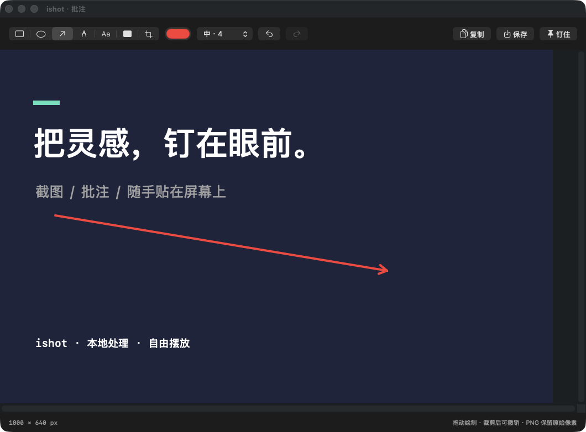
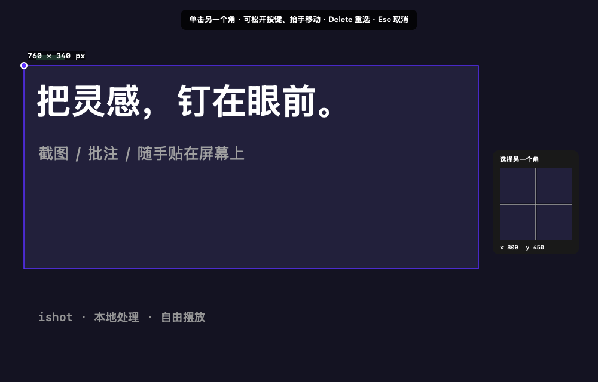

# ishot

**Keep your references in sight.** A native macOS screenshot, annotation, and floating image app.

[简体中文](README.md) · **English**

[Download v0.2.0](https://github.com/sunholdshen/ishot/releases/download/v0.2.0/ishot-0.2.0-universal.dmg) · [All releases](https://github.com/sunholdshen/ishot/releases) · [Report an issue](https://github.com/sunholdshen/ishot/issues)

> **Preview release.** Requires macOS 14 or later. The universal installer contains Apple Silicon and Intel binaries; runtime testing has only been performed on Apple Silicon. The app is ad-hoc signed, **not Developer ID signed or notarized by Apple**. macOS may block the first launch. This independent project is published by [sunholdshen](https://github.com/sunholdshen) and is not affiliated with other products named iShot. **The app UI is currently in Simplified Chinese; English documentation does not imply an English UI.**



## What it does

Capture a code snippet, design reference, or table, then pin it above ordinary windows while you work. Start from the menu bar or a keyboard shortcut. No account or cloud service is required.

## Features

| Area | Available in this preview |
|---|---|
| Capture | Region / display capture; drag or two-point selection, pixel magnifier, movement, corner resizing |
| Annotations | Rectangle, ellipse, arrow, pen, text, opaque cover; color and stroke width |
| Editing | Crop, up to 50 undo / redo steps, source-resolution PNG export |
| **Floating images** | Multiple independent pins, dragging, scroll / trackpad zoom, opacity, position and size lock, further annotations |
| Management | Show / hide all pins; copy, save, or close individual pins |
| Settings | Three configurable global shortcuts, save directory, default pin opacity, launch at login |
| Appearance | Menu bar app with native light and dark modes |

## Download and install

1. [Download the universal DMG](https://github.com/sunholdshen/ishot/releases/download/v0.2.0/ishot-0.2.0-universal.dmg). To install the app, choose the `.dmg`, not GitHub's automatically generated Source code archives.
2. Open it and drag **ishot.app** to **Applications**.
3. Launch from Applications. Find the viewfinder icon in the top menu bar; the app does not keep a Dock icon.
4. Click **开始截图** (Start capture) and grant **Screen Recording** permission when macOS asks. Quit and reopen the app if capture still fails after authorization.
5. Drag a region, or **Option-click the first corner**, release Option, move the pointer, and click the opposite corner. Press **P** to pin or **Enter** to annotate.

### If macOS blocks the first launch

This preview is not notarized. After checking that the download came from this repository and its checksum matches, follow [Apple's official instructions](https://support.apple.com/en-us/102445) to select **Open Anyway** for ishot in **System Settings → Privacy & Security**. Wording and availability vary by macOS version and device policy. You do not need to disable system-wide security checks or use `sudo` to install the app.

If your device policy prevents this, build from source instead. See the [English installation guide](docs/INSTALL.en.md).

### Verify the download

Download both the DMG and its `.sha256` file from the [v0.2.0 release](https://github.com/sunholdshen/ishot/releases/tag/v0.2.0), put them in the same directory, and run:

```sh
shasum -a 256 -c ishot-0.2.0-universal.dmg.sha256
```

The result should be `OK`. A checksum verifies file integrity; it is not Apple notarization.

## Usage

### Capture and annotate

Choose **区域截图** (Region capture) from the menu bar, then drag a selection. Move it or adjust its corners before choosing annotate, copy, save, pin, or cancel. Full-display capture opens the annotation editor.

Select a drawing tool and drag on the image. For text, click the image and enter your annotation. The cover tool uses fully opaque pixels; PNG export replaces the covered source pixels. Cropping flattens existing annotations, but undoing the crop restores them.

### Two-point selection for trackpads

After entering region capture, choose either way to start:

- **Temporary mode:** hold Option (⌥) and click the first corner. You can release Option immediately after the first click.
- **Default mode:** open **设置 → 截图 → 默认框选方式** (Settings → Capture → Default selection method) and choose **双点** (Two-point). Then the first click needs no modifier.

Once the first point is anchored, move the pointer freely. Lift and reposition your fingers as often as needed; a live rectangle follows the pointer with no timeout between clicks. The second click fixes the selection and reveals the toolbar. It **does not automatically save, copy, or pin** the image.

- Use two separate clicks, not a double-click. Any pair of diagonal corners works.
- **Delete** clears the first point so you can choose again; **Esc** cancels the capture.
- A nearby magnifier displays source pixels and repositions near screen edges.
- After confirmation, move the region or resize its corners, then press **P** to pin or use the toolbar.
- A second point producing a width or height smaller than 2 display points is ignored; choose a valid opposite corner.
- Direct dragging still works in two-point mode. Drag is the initial default. An Option-click changes only the current capture session, not the saved preference.
- Both points must be on the same display. Return to the first point's display to finish or cancel.



### Work with pins

- Drag the image to move it.
- Scroll or pinch the trackpad to resize it.
- Hold **Option while scrolling** to change opacity.
- Double-click to restore the original display size, subject to screen size limits.
- Hover to reveal controls. Right-click to annotate, copy, save, lock, or close.
- Pins float above ordinary windows and join desktop spaces. They do not cover system security dialogs.
- **Save images you want to keep before quitting.** This version does not restore pins after exit.

### Default shortcuts

| Action | Shortcut |
|---|---|
| Capture a region | ⌘⇧⌥3 |
| Capture the display under the pointer | ⌘⇧⌥4 |
| Show / hide all pins | ⌘⇧⌥P |
| Temporary two-point mode / reset first point | ⌥ + click / Delete |
| Selection: pin / annotate / copy / save / cancel | P / Enter / C / S / Esc |
| Editor: undo / redo | ⌘Z / ⇧⌘Z |
| Editor: copy / save / pin | ⌘C / ⌘S / ⌘P |

To customize a global shortcut, open **设置 → 快捷键** (Settings → Shortcuts), click its button, and press a new combination. Include Command or Control plus a letter or digit. If a combination is already taken, choose another or use the menu bar.

## Privacy and permissions

- Images are processed locally. There are no accounts, upload endpoints, ads, or usage analytics.
- Captures stay in memory until you save them. Copying writes the image to the system clipboard.
- Capture requires Screen Recording permission. Accessibility and Input Monitoring permission are not required.
- Preferences are stored locally with UserDefaults. Launch at login uses the system login item service.
- Cross-device synchronization of the clipboard or your chosen save directory is controlled by macOS and other software.

## Build from source

Requires macOS 14+ and Xcode Command Line Tools / Xcode supporting Swift 5.9+. There are no third-party Swift dependencies, and a paid Apple developer membership is not required for local builds.

```sh
xcode-select --install  # Skip if already installed

git clone https://github.com/sunholdshen/ishot.git
cd ishot

# Run 30 core checks without XCTest
swift run ishot-checks

# Build dist/ishot.app for the current architecture
./scripts/build.sh

# Or build an Apple Silicon + Intel app and DMG
./scripts/package.sh universal
```

Move `dist/ishot.app` to Applications before normal use. Launch the `.app` so macOS can associate Screen Recording permission with the app. Install to Applications before enabling launch at login.

Optional checks:

```sh
./dist/ishot.app/Contents/MacOS/ishot --smoke-test
./dist/ishot.app/Contents/MacOS/ishot --capture-check
```

`--capture-check` prints SKIP if permission has not been granted. With permission, it exercises the capture API without saving desktop content.

## Validation and limitations

On an Apple Silicon Mac, the app passed 30 core checks, window operation checks, a real capture check, light / dark UI review, and DMG verification. The detailed [validation record](docs/QA.md) is currently in Chinese.

- Each region capture is limited to one display; there is no cross-display stitching. Full capture uses the display under the pointer.
- Capture excludes ishot's own windows, including existing pins.
- Mixed-scale multi-display setups, other macOS versions, and Intel hardware need further testing.
- First-time permission, login item, and downloaded-app Gatekeeper flows need broader user validation.
- Re-editing a pin starts from the flattened image; previous annotation objects cannot be individually edited.
- No scrolling capture, automatic window selection, OCR, recording, click-through, or pin restoration after exit.
- Floating behavior in full-screen apps, Spaces, and special system windows may vary by configuration.

## Project layout

```text
Sources/IShotCore/      Pixel mapping, rendering, edit history, PNG export
Sources/ishot/          Menu bar, selection, editor, pins, settings, shortcuts
Tests/IShotCoreTests/   Standalone core check runner
Resources/             App metadata and icon
scripts/               Build and DMG packaging
.github/workflows/     macOS CI: checks, build, installer artifacts
docs/                  Installation, architecture, QA, screenshots
```

## Contributing

[Issues](https://github.com/sunholdshen/ishot/issues) and pull requests are welcome. For bugs, include your macOS version, chip type, reproduction steps, expected behavior, and actual behavior. Redact private content before sharing screenshots.

Run `swift run ishot-checks` and `./scripts/build.sh` after making changes. Record the tested environment for UI, permission, and multi-display changes. CI does not publish releases automatically; a maintainer reviews and publishes installers.

Planned improvements include Developer ID signing and notarization, broader hardware testing, English UI, pin restoration, click-through mode, and pinning clipboard or local images.

## License

[MIT](LICENSE). Copyright © 2026 sunholdshen and contributors.
