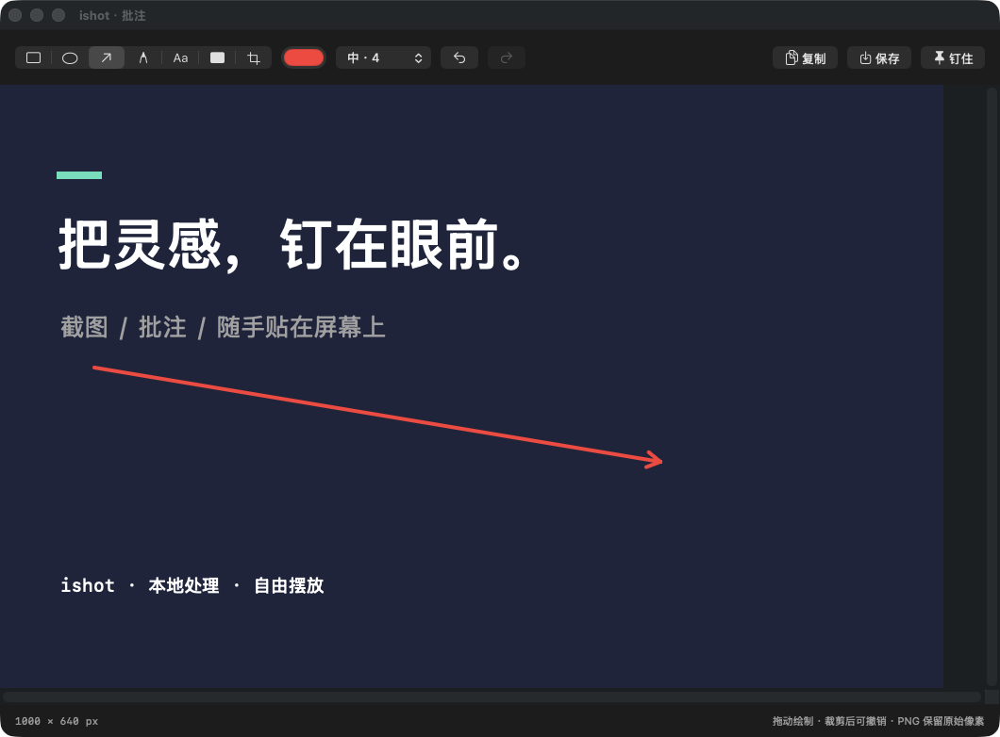

# ishot

**把参考，钉在眼前。** 原生 macOS 截图、批注和悬浮贴图工具。

**简体中文** · [English](README.en.md)

[下载 v0.1.0 安装包](https://github.com/sunholdshen/ishot/releases/download/v0.1.0/ishot-0.1.0-universal.dmg) · [全部发布版本](https://github.com/sunholdshen/ishot/releases) · [反馈问题](https://github.com/sunholdshen/ishot/issues)

> **预览版**：要求 macOS 14 或更新版本。安装包包含 Apple 芯片和 Intel 架构，仅在 Apple 芯片 Mac 上完成运行验证。使用 ad-hoc 本地签名，**没有 Developer ID 签名和 Apple 公证**，首次打开可能被 macOS 拦截。本项目由 [sunholdshen](https://github.com/sunholdshen) 发布，与已有同名 iShot 产品无关联。当前应用界面为简体中文，英文支持目前指文档。



## 为什么做 ishot

截取一段代码、一张设计图或一个待核对的数据表，把它钉在其他窗口上方，边看边工作。无需登录、无需云服务，常用操作都可以从菜单栏或快捷键发起。

## 功能

| 模块 | 已实现 |
|---|---|
| 截图 | 区域截图、鼠标所在显示器全屏截图；冻结画面、移动选区、调整四角 |
| 批注 | 矩形、椭圆、箭头、画笔、文字、不透明遮挡；颜色和粗细 |
| 编辑 | 裁剪，最多 50 步撤销 / 重做；保留原始像素导出 PNG |
| **悬浮贴图** | 多张独立贴图、拖动、滚轮 / 触控板缩放、透明度、锁定、继续批注 |
| 管理 | 一键显示 / 隐藏全部贴图，单张复制 / 保存 / 关闭 |
| 设置 | 自定义三组全局快捷键、默认保存目录、默认贴图透明度、登录时启动 |
| 外观 | 菜单栏常驻，原生浅色 / 深色模式 |

## 下载与安装

1. [下载 Universal DMG](https://github.com/sunholdshen/ishot/releases/download/v0.1.0/ishot-0.1.0-universal.dmg)。如果只想安装软件，请下载 `.dmg`，不是 GitHub 自动生成的 Source code 压缩包。
2. 打开 DMG，将 **ishot.app** 拖入 **Applications（应用程序）**。
3. 从 Applications 启动。应用常驻屏幕顶部的取景框菜单栏图标，不常驻 Dock。
4. 点击“开始截图”，按系统提示允许**屏幕录制**。若授权后仍无法截图，请退出并重新打开应用。
5. 拖动选取区域，按 **P** 直接钉住，按 **Enter** 进入批注。

### 首次打开被系统拦截

本版本未公证。确认下载来自本仓库且文件校验值匹配后，可按 [Apple 官方说明](https://support.apple.com/en-us/102445)，在 **系统设置 → 隐私与安全性** 中对 ishot 选择 **仍要打开**。不同 macOS 版本的提示可能不同。无需关闭系统全局安全检查，也无需使用 `sudo` 安装。

如系统策略不允许打开，可从源码自行构建。更完整的步骤见 [中文安装说明](docs/INSTALL.zh-CN.md)。

### 校验下载文件

在 [v0.1.0 Release](https://github.com/sunholdshen/ishot/releases/tag/v0.1.0) 同时下载 DMG 和同名 `.sha256` 文件，将它们放在同一目录，运行：

```sh
shasum -a 256 -c ishot-0.1.0-universal.dmg.sha256
```

应显示 `OK`。校验值用于验证文件完整性，不代表 Apple 公证。

## 使用方法

### 截图与批注

从菜单栏选择“区域截图”，拖动选框，选中后可以移动选区或拖动四角调整大小。工具栏提供批注、复制、保存、钉住和取消。全屏截图会打开批注编辑器，再按需复制、保存或钉住。

编辑器中选择工具后拖动绘制；文字工具点击图片后输入文字。遮挡工具绘制完全不透明的色块，PNG 导出会覆盖原来的像素。裁剪会合成已有批注，但可以撤销裁剪来恢复。

### 贴图

- 按住图片拖动位置。
- 滚轮或触控板捏合调整大小。
- **Option + 滚轮**调整透明度。
- 双击恢复原始尺寸，仍受屏幕尺寸限制。
- 鼠标移入显示操作按钮；右键可以继续批注、复制、保存、锁定和关闭。
- 贴图位于普通窗口上方，并跟随桌面空间；不会覆盖系统安全提示。
- **退出前保存需要保留的图片。** 本版不自动恢复贴图。

### 默认快捷键

| 操作 | 快捷键 |
|---|---|
| 区域截图 | ⌘⇧⌥3 |
| 当前显示器全屏截图 | ⌘⇧⌥4 |
| 显示 / 隐藏全部贴图 | ⌘⇧⌥P |
| 选区：钉住 / 批注 / 复制 / 保存 / 取消 | P / Enter / C / S / Esc |
| 编辑器：撤销 / 重做 | ⌘Z / ⇧⌘Z |
| 编辑器：复制 / 保存 / 钉住 | ⌘C / ⌘S / ⌘P |

在“设置 → 快捷键”中点击组合，再按下新的组合；需包含 Command 或 Control，以及字母或数字。发生冲突时可换一组，或直接使用菜单栏操作。

## 隐私与权限

- 所有图像在本机处理；没有账号、上传接口、广告或使用统计。
- 截图默认留在内存中，点击“保存”才写入文件；“复制”会将图片写入系统剪贴板。
- 截图需要屏幕录制权限，不需要辅助功能或输入监控权限。
- 应用设置使用本机 UserDefaults 保存；开机启动使用系统登录项服务。
- 剪贴板及用户所选保存目录的跨设备同步由 macOS 和其他软件控制。

## 从源码构建

需要 macOS 14+ 和支持 Swift 5.9+ 的 Xcode Command Line Tools / Xcode；没有第三方 Swift 依赖，无需付费开发者账号。

```sh
xcode-select --install  # 已安装命令行开发工具时可跳过

git clone https://github.com/sunholdshen/ishot.git
cd ishot

# 运行 19 项核心检查（不依赖 XCTest）
swift run ishot-checks

# 生成当前架构的 dist/ishot.app
./scripts/build.sh

# 或生成 Apple 芯片 + Intel 的通用应用和 DMG
./scripts/package.sh universal
```

将 `dist/ishot.app` 拖入 Applications 后打开。正常使用请启动 `.app`，以便系统将录屏权限关联到应用；设置登录时启动前，也应先安装到 Applications。

可选检查：

```sh
./dist/ishot.app/Contents/MacOS/ishot --smoke-test
./dist/ishot.app/Contents/MacOS/ishot --capture-check
```

`--capture-check` 在未授权时输出 SKIP；已有授权时验证截图接口，不保存桌面内容。

## 验证范围与已知限制

已在 Apple 芯片 Mac 上通过 19 项核心检查、窗口操作检查、真实截图、浅色 / 深色界面检查和 DMG 校验。详见 [验证记录](docs/QA.md)。

- 单次区域截图限定在一个显示器中，不跨屏拼接；全屏截图针对鼠标所在显示器。
- 截图排除 ishot 自身窗口，包括已有贴图。
- 多显示器混合缩放、其他 macOS 版本和 Intel 真机仍需进一步测试。
- 首次授权、登录项、Gatekeeper 下载拦截等流程仍需更多真实用户验证。
- 从贴图继续批注时使用已合成的图片，无法独立修改上一次的批注对象。
- 不支持滚动截图、窗口自动吸附、OCR、录屏、鼠标穿透或退出后恢复贴图。
- 全屏应用、Spaces 和特殊系统窗口的置顶行为可能因系统配置而异。

## 项目结构

```text
Sources/IShotCore/      像素映射、批注渲染、编辑历史、PNG 导出
Sources/ishot/          菜单栏、截图选区、编辑器、贴图、设置、快捷键
Tests/IShotCoreTests/   独立核心检查程序
Resources/             应用元数据与图标
scripts/               构建和 DMG 打包
.github/workflows/     macOS CI：检查、构建和上传安装包 artifact
docs/                  安装、架构、验证记录与界面截图
```

## 参与贡献

欢迎提交 [Issue](https://github.com/sunholdshen/ishot/issues) 和 Pull Request。Bug 报告请附上 macOS 版本、芯片类型、复现步骤、预期与实际结果；分享截图前请遮盖私人内容。

修改后运行 `swift run ishot-checks` 和 `./scripts/build.sh`。涉及 UI、权限或多显示器的修改，请记录实际测试环境。CI 不会自动发布 Release；安装包由维护者检查后发布。

后续方向：Developer ID 签名与公证、更多真机测试、英文界面、贴图恢复、鼠标穿透、剪贴板 / 本地图片贴图。

## 许可证

[MIT](LICENSE)。Copyright © 2026 sunholdshen and contributors。
